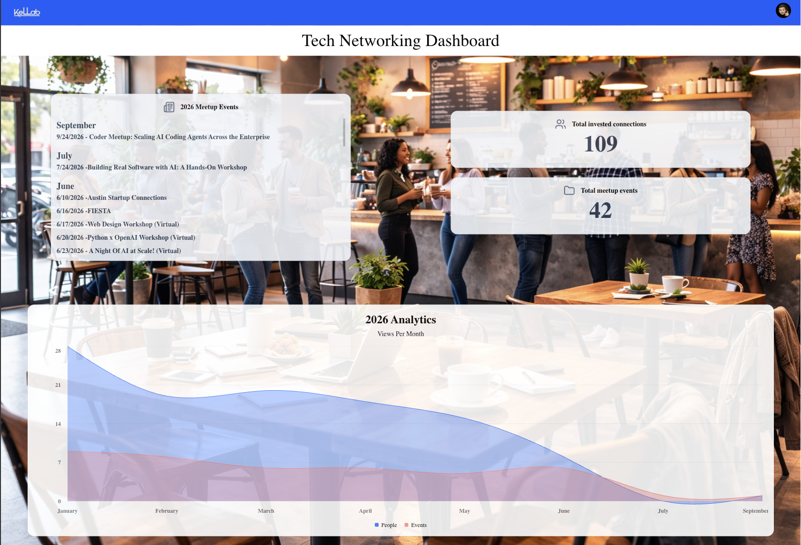

# Tech Networking Dashboard

A dashboard for tracking technology networking meetups and the connections made through them. It reads event data from a Google Sheet and presents the 2026 meetup schedule, summary totals for events attended and connections made, and monthly analytics in one place. Background image is AI.

## Current project goal

The current implementation is a read-only dashboard for reviewing 2026 meetup activities. It lists events by month and summarizes the number of meetup events and invested connections recorded in my google spreadsheet.

## Site structure

- `app/page.tsx` — dashboard page; reads spreadsheet rows, groups event entries by month, and calculates summary totals.
- `app/layout.tsx` — shared application layout, metadata, fonts, and navigation.
- `app/globals.css` — global styles, theme tokens, and page background.
- `components/ui/Navbar.tsx` — header with the home link, logo, and avatar.
- `components/dashboard/DashboardCard.tsx` — reusable event list and metric card.
- `components/dashboard/AnalyticsChart.tsx` — monthly area chart for events and people.
- `components/graph/GraphMetrics.tsx` — prepares monthly chart data from spreadsheet rows.
- `components/ui/` — shared card, chart, and avatar UI components.
- `src/action.ts` — server-side Google Sheets API access.
- `public/img/` — dashboard logo, avatar, and background image.

## Data and state

There is no application database or persistent client-side state. The dashboard fetches its data from Google Sheets on the server when the page is rendered; totals and chart data are derived from those rows.

The expected columns are:

| Column | Value                                     |
| ------ | ----------------------------------------- |
| A      | Month (may be blank on continuation rows) |
| B      | Event date                                |
| C      | Event place                               |
| D      | Number of events                          |
| E      | Number of invested connections            |

Rows after the first row are treated as data; the first row is skipped as a header.

## Tech stack

- Next.js 16 App Router and React 19
- TypeScript
- Tailwind CSS 4 and shadcn-style UI components
- Recharts for analytics charts
- Google Sheets API via `googleapis`
- Lucide React icons

## Notes for continued development

- Keep Google API access in server-side code; do not expose service-account credentials to browser code.
- Preserve the spreadsheet column order or update the row mapping and this documentation together if the schema changes.
- Keep month grouping consistent between the event list and chart aggregation.
- The dashboard is configured around 2026 data in its page labels, chart title, and default sheet range. Update all of these together when adding another reporting year.
- `getGoogleSheet` currently logs retrieval errors and returns `null`; callers should account for unavailable sheet data when improving loading and error states.

## Growing the project

- When adding a feature, keep route-level composition in `app/`, reusable presentation in `components/`, and server-side integrations or data access in `src/`.
- Add shared UI primitives under `components/ui/` when they are reused.
- Archive previous years of networking.
- Adding an AI component to alert others of event locations and times when viewing the dashboard.

## Future improvements

- Potentially migrating to PostgreSQL as data demands increase.
- Adding a search field as dashboard needs expand.
